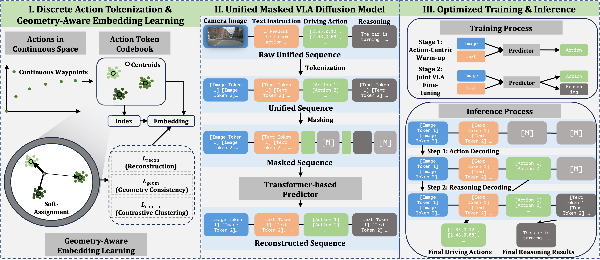

# MVLAD-AD: Efficient and Explainable End-to-End Autonomous Driving via Masked Vision-Language-Action Diffusion

[](https://arxiv.org/abs/2602.20577)


This repository provides the official implementation of **MVLAD-AD** (Masked Vision-Language-Action Diffusion for Autonomous Driving), proposed in our paper *Efficient and Explainable End-to-End Autonomous Driving via Masked Vision-Language-Action Diffusion*. MVLAD-AD is a unified, non-autoregressive framework that casts end-to-end driving as conditional masked generative modeling, jointly producing future trajectories and natural-language explanations within a single bidirectional diffusion process.

## Overview
<p align="center"></p>
<p align="center"><em>Overview of MVLAD-AD: discrete action tokenization and
geometry-aware embedding learning, unified masked VLA diffusion, and
action-priority decoding.</em></p>

## Setup

```bash
source setup_env.sh           # sets PYTHONPATH and default paths
# install the model package (editable):
pip install -e train
```

Edit the exported paths in `setup_env.sh` (or export before sourcing):

- `NUSCENES_ROOT` — nuScenes v1.0-trainval root (required for data prep).
- `LLADA_V_PATH` — base diffusion VLM (default `GSAI-ML/LLaDA-V` from HF).
- `SIGLIP_PATH`  — vision encoder (default `google/siglip2-so400m-patch14-384`).

The base models are downloaded from HuggingFace at first run. Since LLaDA-V
builds on a gated LLaMA-3 tokenizer, run `huggingface-cli login` (with access
granted) beforehand, or point the variables above to local snapshots for fully
offline use.

## Pipeline

### 1. Action tokenizer (codebook + geometry-aware embeddings)

```bash
cd tokenizer
python test.py            # build K-Means codebook from nuScenes waypoints
python tokenizer.py       # train geometry-aware embeddings -> tokenizer_model.pth
python find_unused_tokens.py   # pick vocabulary slots -> unused_token_ids.npy
```

Pretrained `tokenizer_model.pth` and `unused_token_ids.npy` are already
included, so this step is optional for reproduction.

### 2. Data generation

The dataset JSONs are **not shipped** (they are large and derived from
nuScenes). Generate them after setting `NUSCENES_ROOT`; all files are written
to `data/` by default (`VLAD_DATA_DIR`).

```bash
python data_prep/gen_data_planning.py   # planning JSON
python data_prep/gen_data_nux.py        # Nu-X JSON (needs Nu_X_{train,val}.json)
```

| File | Produced by | Used for |
|------|-------------|----------|
| `nuscenes_waypoint_text_long_prompt_{train,val}.json` | `data_prep/gen_data_planning.py` | planning (Stage 1) |
| `nuscenes_waypoint_text_long_prompt_{train,val}_Nu_X.json` | `data_prep/gen_data_nux.py` | Nu-X (Stage 2) |
| `Nu_X_{train,val}.json` | Nu-X dataset (Hint-AD / dinghint), public release | raw narration+reasoning consumed by `gen_data_nux.py` |

Each generated sample carries the front-camera image path, the future
ego-frame waypoints (`action_targets`), and a conversation whose answer is the
waypoint string (planning) optionally followed by `Narration:` / `Reasoning:`
segments (Nu-X).

### 3. Training (two-stage)

```bash
# Stage 1: action-centric warm-up (planning only)
bash train/scripts/stage1_action_warmup.sh

# Stage 2: joint VLA fine-tuning (init from Stage-1 LoRA)
INIT_LORA_DIR=exp/stage1_action_warmup_XXXX \
TRAIN_JSON="$VLAD_DATA_DIR/nuscenes_waypoint_text_long_prompt_train_Nu_X.json" \
bash train/scripts/stage2_joint_vla.sh
```

LoRA rank `r=256`; the paper trains 4×H100, bf16, global batch size 32, 8 epochs
per stage (≈9 h). Adjust `gradient_accumulation_steps` / GPU count accordingly.

### 4. Inference (action-priority decoding)

```bash
python inference/run_inference.py --task planning   # -> results/planning_result.json
python inference/run_inference.py --task nux        # -> results/nu_x_result.json
```

`planning` runs single-stage action decoding; `nux` runs two-stage decoding
(resolve action tokens first, then in-fill reasoning).

### 5. Evaluation

```bash
# nuScenes planning: L2 @1s/2s/3s + average
python train/scripts/compute_lora_metrics_from_json.py --results results/planning_result.json

# Nu-X: BLEU-4 / METEOR / ROUGE-L / CIDEr
python eval/eval_nux.py --results results/nu_x_result.json
```

## Weights

Each task ships a LoRA adapter (~400 MB: `adapter_model.safetensors` +
`non_lora_trainables.bin` + configs). The base LLaDA-V / SigLIP2 weights are
pulled from HuggingFace and merged with the adapter at load time.

| Task | Adapter | Description |
|---|---|---|
| Planning | `weights/planning/` | Stage-1 action warm-up LoRA for waypoint prediction. |
| Nu-X | `weights/nu_x/` | Stage-2 joint VLA LoRA for planning with explanation. |
